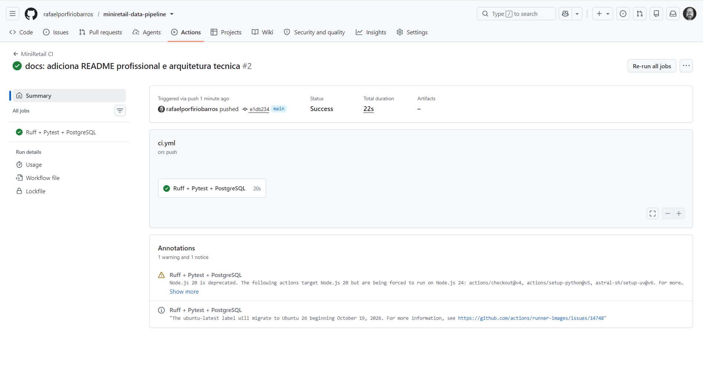

# MiniRetail Data Pipeline

**Pipeline ETL com Python, PostgreSQL, SQL, Docker, testes automatizados e GitHub Actions.**

Projeto educacional de Engenharia de Dados que simula o processamento de vendas de uma empresa varejista fictícia, desde a geração dos dados até a disponibilização de indicadores analíticos.

O objetivo é demonstrar como construir uma solução de dados **reproduzível, testável, documentada e orientada a problemas de negócio**.

> **Nota:** todos os dados são sintéticos. Os indicadores apresentados não representam o desempenho de uma empresa real.

## Resultados do projeto

| Indicador | Resultado |
|---|---:|
| Vendas processadas | 1.000 |
| Faturamento simulado | R$ 62.604,50 |
| Unidades vendidas | 5.588 |
| Ticket médio aproximado | R$ 62,60 |
| Período analisado | Janeiro a março de 2026 |
| Testes automatizados | 48 aprovados |
| Integração contínua | GitHub Actions aprovado |

Os indicadores foram obtidos a partir da execução do pipeline e das consultas SQL sobre os dados sintéticos.

## 1. Problema de negócio

Uma empresa varejista recebe registros de vendas e precisa transformar essas informações em dados confiáveis para apoiar decisões comerciais e operacionais.

Entre as principais perguntas estão:

- Qual é o faturamento total?
- Como as vendas evoluem ao longo dos meses?
- Quais produtos apresentam maior faturamento?
- Quais categorias contribuem mais para a receita?
- Quantas unidades foram vendidas?
- Qual é o ticket médio?
- Como garantir a qualidade e a integridade das informações?

O MiniRetail implementa uma solução ETL que organiza esses registros em um banco relacional e disponibiliza consultas analíticas reutilizáveis.

## 2. Tecnologias utilizadas

| Tecnologia | Aplicação no projeto |
|---|---|
| Python 3.12 | Desenvolvimento do ETL |
| UV | Gerenciamento de dependências |
| PostgreSQL 17 | Armazenamento relacional |
| SQL | Modelagem, validação e analytics |
| Docker Compose | Infraestrutura local |
| Psycopg 3 | Comunicação Python/PostgreSQL |
| Pytest | Testes automatizados |
| Ruff | Qualidade e formatação do código |
| Git e GitHub | Versionamento |
| GitHub Actions | Integração contínua |

## 3. Arquitetura da solução

O projeto utiliza uma arquitetura ETL (*Extract, Transform, Load*).

```text
        DADOS SINTÉTICOS
        generate_data.py
               |
               v
         data/vendas.csv
               |
               v
         EXTRAÇÃO (E)
           extract.py
               |
               v
       TRANSFORMAÇÃO (T)
          transform.py
               |
               v
           CARGA (L)
            load.py
               |
               v
          POSTGRESQL
         retail.vendas
               |
               v
        VIEWS ANALÍTICAS
        sql/analytics.sql
               |
               v
      INDICADORES DE NEGÓCIO
```

O módulo `pipeline.py` coordena a extração, transformação e carga.

### Extração

O arquivo CSV é lido e sua estrutura é validada antes do processamento.

### Transformação

Os registros são convertidos em objetos Python tipados e submetidos a regras de validação.

### Carga

Os registros válidos são inseridos no PostgreSQL utilizando Psycopg 3.

A cláusula `ON CONFLICT (id_venda) DO NOTHING` evita novas inserções para identificadores já existentes.

Essa abordagem permite reprocessar o mesmo arquivo sem duplicar vendas, mas não atualiza automaticamente registros existentes que tenham sido modificados.

### Analytics

Seis views SQL disponibilizam indicadores consolidados, análises temporais, rankings de produtos e desempenho por categoria.

A documentação detalhada está disponível em [Arquitetura Técnica](docs/arquitetura.md).

## 4. Estrutura do projeto

```text
miniretail-data-pipeline/
|
|-- .github/
|   |-- workflows/
|       |-- ci.yml
|
|-- data/
|   |-- vendas.csv              # Gerado localmente
|
|-- docs/
|   |-- arquitetura.md
|
|-- sql/
|   |-- 001_schema.sql
|   |-- 002_security_roles.sql
|   |-- analytics.sql
|   |-- analytics_checks.sql
|   |-- data_quality_checks.sql
|
|-- src/
|   |-- miniretail/
|       |-- generate_data.py
|       |-- extract.py
|       |-- transform.py
|       |-- load.py
|       |-- pipeline.py
|
|-- tests/
|   |-- conftest.py
|   |-- test_analytics.py
|   |-- test_data_quality.py
|   |-- test_database_isolation.py
|   |-- test_database_security.py
|   |-- test_extract.py
|   |-- test_generate_data.py
|   |-- test_load.py
|   |-- test_pipeline_integration.py
|   |-- test_postgres_transactions.py
|   |-- test_project.py
|   |-- test_transform.py
|
|-- compose.yaml
|-- pyproject.toml
|-- uv.lock
|-- README.md
```

O arquivo `data/vendas.csv` é gerado durante a execução e não precisa ser versionado.

## 5. Pré-requisitos

Para reproduzir o projeto localmente:

- Python 3.12 ou superior.
- UV instalado.
- Docker Desktop com Docker Compose.
- Git.
- VS Code ou outro editor de código.
- PowerShell para executar os comandos apresentados.

As instruções abaixo consideram Windows e PowerShell.

## 6. Instalação e configuração

### 6.1. Clonar o repositório

```powershell
git clone https://github.com/rafaelporfiriobarros/miniretail-data-pipeline.git

cd miniretail-data-pipeline
```

### 6.2. Instalar as dependências

```powershell
uv sync --frozen --dev
```

O UV utiliza o arquivo `uv.lock` para instalar as versões de dependências registradas no projeto.

### 6.3. Configurar as variáveis de ambiente

Crie um arquivo `.env` na raiz do projeto:

```dotenv
DATABASE_HOST=127.0.0.1
DATABASE_PORT=55435
DATABASE_NAME=miniretail
DATABASE_USER=miniretail_app
DATABASE_PASSWORD=SUBSTITUA_POR_UMA_SENHA_LOCAL_FORTE
```

Substitua o valor de exemplo por uma senha exclusiva do ambiente local.

**Nunca publique o arquivo `.env` ou credenciais reais no GitHub.**

O arquivo `compose.yaml` utiliza essas variáveis para inicializar o PostgreSQL.

Para disponibilizar as mesmas variáveis aos processos Python executados no PowerShell:

```powershell
Get-Content .env |
    Where-Object { $_ -match '^\s*[A-Za-z_][A-Za-z0-9_]*=' } |
    ForEach-Object {
        $name, $value = $_ -split '=', 2
        [Environment]::SetEnvironmentVariable(
            $name.Trim(),
            $value.Trim(),
            'Process'
        )
    }
```

Esse procedimento pressupõe um `.env` simples, sem valores multilinha ou sintaxe avançada de interpolação.

### 6.4. Iniciar o PostgreSQL

```powershell
docker compose up -d
```

Verifique o estado do serviço:

```powershell
docker compose ps
```

O PostgreSQL deverá estar disponível na porta local `55435`.

**Atenção:** o banco é persistido em um volume Docker. Alterações posteriores nas variáveis de inicialização não recriam automaticamente usuários ou bancos existentes.

## 7. Preparação do banco de dados

### 7.1. Criar o schema

```powershell
Get-Content .\sql\001_schema.sql -Raw |
    docker compose exec -T postgres `
        psql -U miniretail_app -d miniretail `
        -v ON_ERROR_STOP=1
```

O script cria o schema `retail`, a tabela `retail.vendas`, restrições de integridade e um índice por data.

### 7.2. Criar as views analíticas

```powershell
Get-Content .\sql\analytics.sql -Raw |
    docker compose exec -T postgres `
        psql -U miniretail_app -d miniretail `
        -v ON_ERROR_STOP=1
```

### 7.3. Gerar os dados sintéticos

```powershell
uv run python -m miniretail.generate_data
```

O comando cria o arquivo `data/vendas.csv` com 1.000 registros reproduzíveis.

### 7.4. Executar o pipeline ETL

```powershell
uv run python -m miniretail.pipeline
```

Na primeira execução sobre uma tabela vazia, o resultado esperado é:

```text
Resumo do pipeline
Extraídos: 1000
Válidos: 1000
Rejeitados: 0
Inseridos: 1000
```

Se o mesmo arquivo for reprocessado, os registros existentes não serão inseridos novamente.

## 8. Consultas e indicadores de negócio

### 8.1. Consultar o resumo das vendas

```powershell
docker compose exec postgres `
    psql -U miniretail_app -d miniretail `
    -c "SELECT * FROM retail.vw_resumo_vendas;"
```

### 8.2. Consultar o faturamento mensal

```powershell
docker compose exec postgres `
    psql -U miniretail_app -d miniretail `
    -c "SELECT * FROM retail.vw_vendas_mensais;"
```

### 8.3. Consultar o ranking de produtos

```powershell
docker compose exec postgres `
    psql -U miniretail_app -d miniretail `
    -c "SELECT * FROM retail.vw_ranking_produtos;"
```

### 8.4. Consultar o desempenho por categoria

```powershell
docker compose exec postgres `
    psql -U miniretail_app -d miniretail `
    -c "SELECT * FROM retail.vw_categorias;"
```

### 8.5. Validar a quantidade de vendas

```powershell
docker compose exec postgres `
    psql -U miniretail_app -d miniretail `
    -c "SELECT COUNT(*) AS total_vendas FROM retail.vendas;"
```

Com o conjunto padrão, o resultado esperado é de 1.000 registros.

## 9. Qualidade de dados

O MiniRetail utiliza validações em diferentes camadas.

**Python:** verifica os registros durante a transformação.

**PostgreSQL:** utiliza chave primária, restrições `CHECK` e tipos de dados para proteger a integridade da tabela.

**SQL:** executa consultas específicas para identificar possíveis violações de qualidade.

Para executar as verificações SQL:

```powershell
Get-Content .\sql\data_quality_checks.sql -Raw |
    docker compose exec -T postgres `
        psql -U miniretail_app -d miniretail `
        -v ON_ERROR_STOP=1
```

As verificações contemplam duplicidade de IDs, quantidades inválidas, preços negativos, totais inconsistentes, campos vazios e datas futuras.

## 10. Testes automatizados

O projeto utiliza Pytest para validar:

- Geração de dados.
- Extração e transformação.
- Regras de negócio.
- Carga e idempotência.
- Integração com PostgreSQL.
- Transações e rollback.
- Isolamento do banco de testes.
- Qualidade de dados.
- Indicadores analíticos.
- Permissões de segurança.

### Preparação para testes locais

Os testes de integração e segurança utilizam o banco `miniretail_test`, separado do banco analítico.

Em uma instalação nova, é necessário preparar esse banco antes de executar toda a suíte.

Crie o banco de testes:

```powershell
docker compose exec postgres `
    psql -U miniretail_app -d miniretail `
    -c "CREATE DATABASE miniretail_test OWNER miniretail_app;"
```

Aplique o schema:

```powershell
Get-Content .\sql\001_schema.sql -Raw |
    docker compose exec -T postgres `
        psql -U miniretail_app -d miniretail_test `
        -v ON_ERROR_STOP=1
```

Crie as views:

```powershell
Get-Content .\sql\analytics.sql -Raw |
    docker compose exec -T postgres `
        psql -U miniretail_app -d miniretail_test `
        -v ON_ERROR_STOP=1
```

Configure as roles de segurança no ambiente de testes:

```powershell
Get-Content .\sql\002_security_roles.sql -Raw |
    docker compose exec -T postgres `
        psql -U miniretail_app -d miniretail_test `
        -v ON_ERROR_STOP=1
```

O comando de criação do banco deve ser executado apenas se `miniretail_test` ainda não existir.

### Executar a suíte

```powershell
uv run pytest -v -rs
```

**Resultado da validação realizada na Etapa 5: 48 testes aprovados.**

### Verificar a qualidade do código

```powershell
uv run ruff check .
uv run ruff format --check .
```

Esses comandos verificam regras de lint e formatação sem modificar os arquivos.

## 11. Segurança

O projeto utiliza variáveis de ambiente para configurar a conexão com o PostgreSQL.

Também demonstra a separação de permissões por meio de duas roles de laboratório:

| Role | Responsabilidade |
|---|---|
| `miniretail_loader` | Consulta e inserção de vendas |
| `miniretail_reader` | Consulta de tabelas e views autorizadas no banco de testes |

As roles são `NOLOGIN` e não possuem privilégios administrativos.

A aplicação ainda utiliza uma conta de conexão administrativa no ambiente de desenvolvimento. A migração para uma identidade restrita permanece como melhoria futura.

**O projeto não deve ser considerado pronto para produção sem uma revisão adicional de segurança e permissões.**

## 12. Integração contínua — GitHub Actions

O workflow está definido em:

`.github/workflows/ci.yml`

A integração contínua executa automaticamente:

1. Preparação do ambiente Python e UV.
2. Inicialização de um PostgreSQL temporário.
3. Criação dos bancos necessários.
4. Aplicação do schema e das views.
5. Configuração das roles.
6. Geração e carga dos dados sintéticos.
7. Verificação do código com Ruff.
8. Execução dos testes com Pytest.

A primeira execução foi aprovada no commit `5fdb524`, com duração total de 22 segundos.

As execuções podem ser acompanhadas na aba **Actions** do repositório.

### Evidências de execução

O projeto possui evidências documentadas de testes automatizados, qualidade de dados e integração contínua.

A execução do GitHub Actions referente ao commit `e1db234` foi concluída com sucesso em 22 segundos.



**Documentação complementar:** [Evidências técnicas do projeto](docs/evidencias.md).

As evidências demonstram a execução das verificações automatizadas em um ambiente independente do desenvolvimento local.

## 13. Decisões técnicas e aprendizados

O projeto foi desenvolvido com foco nos fundamentos de Engenharia de Software e Engenharia de Dados.

### Modularização

Cada responsabilidade do ETL foi organizada em um módulo específico, facilitando manutenção, testes e evolução.

### Integridade

As regras de transformação Python são complementadas por restrições PostgreSQL.

### Idempotência

A carga evita duplicações de IDs durante reprocessamentos.

### Isolamento

Os testes que modificam dados utilizam um banco separado do ambiente analítico.

### Reprodutibilidade

O gerador utiliza uma semente fixa, e o projeto mantém dependências versionadas no `uv.lock`.

### Integração contínua

O GitHub Actions permite executar verificações em um ambiente temporário, reduzindo a dependência da configuração local.

## 14. Limitações e melhorias futuras

O MiniRetail é uma implementação educacional e ainda não contempla todos os recursos de uma plataforma de dados produtiva.

Entre as evoluções possíveis estão:

- Modelagem dimensional com fatos e dimensões.
- Carga incremental com tratamento de atualizações.
- Logs estruturados e observabilidade.
- Histórico de execuções e auditoria.
- Monitoramento contínuo da qualidade de dados.
- Dashboards no Power BI.
- Orquestração e agendamento.
- Contas PostgreSQL com privilégios mínimos.
- Ampliação dos testes de segurança.
- Implantação controlada em ambiente de produção.

## 15. Conclusão

O **MiniRetail Data Pipeline** demonstra como transformar registros transacionais em uma base analítica confiável, utilizando práticas fundamentais de Engenharia de Dados.

A solução integra Python, PostgreSQL, SQL, Docker, testes automatizados e GitHub Actions em um fluxo de processamento reproduzível.

Além dos indicadores gerados, o projeto evidencia competências em **modelagem de dados, desenvolvimento ETL, validação, integridade, testes, versionamento e integração contínua**.

O principal aprendizado é que um pipeline de dados não deve apenas funcionar: ele também precisa ser compreensível, verificável, seguro dentro do seu contexto de uso e preparado para evolução.

---

**Autor:** Rafael Porfírio Barros

**Repositório:** https://github.com/rafaelporfiriobarros/miniretail-data-pipeline