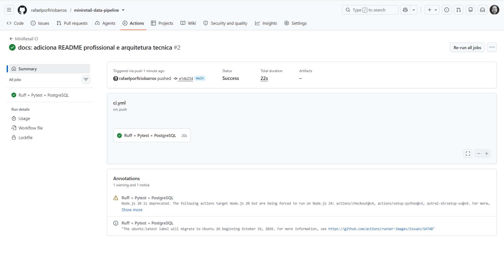

# Evidências Técnicas — MiniRetail Data Pipeline

## 1. Objetivo

Este documento reúne as principais evidências de implementação, execução, qualidade e integração contínua do projeto MiniRetail Data Pipeline.

O projeto utiliza dados sintéticos para demonstrar fundamentos de Engenharia de Dados, incluindo pipelines ETL, PostgreSQL, SQL Analytics, testes automatizados e GitHub Actions.

## 2. Resultados de negócio

O processamento do conjunto padrão de dados sintéticos apresentou os seguintes resultados:

| Indicador | Resultado |
|---|---:|
| Vendas processadas | 1.000 |
| Faturamento simulado | R$ 62.604,50 |
| Unidades vendidas | 5.588 |
| Ticket médio aproximado | R$ 62,60 |
| Período analisado | Janeiro a março de 2026 |

Os indicadores são utilizados exclusivamente para fins educacionais.

## 3. Evidência de integração contínua

O GitHub Actions executou o workflow MiniRetail CI após a publicação da documentação do projeto.

**Informações da execução:**

| Campo | Resultado |
|---|---|
| Workflow | MiniRetail CI |
| Commit | `e1db234` |
| Branch | `main` |
| Evento | Push |
| Status | Success |
| Duração total | 22 segundos |
| Job | Ruff + Pytest + PostgreSQL |

### Captura da execução



A captura demonstra que o workflow concluiu a execução sem falhas.

A execução bem-sucedida confirma a aprovação das verificações configuradas no pipeline de integração contínua.

### Observações de manutenção

A execução apresentou avisos relacionados à depreciação do Node.js 20 em versões de actions utilizadas e à migração da imagem `ubuntu-latest`.

Esses avisos não impediram a conclusão do workflow.

A atualização das actions e a revisão da versão do runner ficam registradas como melhorias futuras.

## 4. Evidências de qualidade e testes

O projeto utiliza Pytest para verificar o comportamento dos componentes.

Na validação local da Etapa 5, foram aprovados **48 testes automatizados**.

A suíte contempla:

- Geração reproduzível de dados sintéticos.
- Extração e transformação de registros.
- Validação de regras de negócio.
- Inserção e prevenção de duplicações.
- Integração com PostgreSQL.
- Transações e rollback.
- Isolamento do banco de testes.
- Consistência dos indicadores.
- Qualidade dos dados.
- Permissões de segurança.

### Comandos de validação

```powershell
uv run ruff check .
uv run ruff format --check .
uv run pytest -v -rs
```

Os testes que dependem de PostgreSQL exigem os bancos e objetos SQL preparados conforme as instruções do README.

## 5. Evidências de Engenharia de Dados

### 5.1. Pipeline ETL

A solução implementa os processos de extração, transformação e carga em módulos Python separados.

O módulo `pipeline.py` coordena a execução.

### 5.2. Integridade

A tabela `retail.vendas` utiliza chave primária, restrições SQL e tipos de dados apropriados.

### 5.3. Idempotência

A carga utiliza `ON CONFLICT (id_venda) DO NOTHING` para evitar a inserção de registros duplicados.

Esse mecanismo não atualiza automaticamente vendas existentes.

### 5.4. Analytics

O projeto disponibiliza seis views SQL para análises de faturamento, evolução temporal, produtos e categorias.

### 5.5. Segurança

Foram criadas roles PostgreSQL de laboratório para demonstrar a separação de permissões.

As roles ainda não são utilizadas como contas de conexão da aplicação.

## 6. Reprodutibilidade

O projeto disponibiliza:

- Dependências Python registradas no `uv.lock`.
- Infraestrutura local com Docker Compose.
- Gerador de dados sintéticos com semente fixa.
- Scripts SQL para criação de objetos.
- Testes automatizados.
- Workflow de integração contínua.
- Instruções de execução no README.

Esses elementos permitem reproduzir e verificar o comportamento da solução.

## 7. Conclusão

As evidências demonstram que o MiniRetail Data Pipeline possui uma implementação funcional e testada, com geração de dados sintéticos, processamento ETL, armazenamento PostgreSQL, consultas analíticas e integração contínua.

O projeto demonstra competências fundamentais de Engenharia de Dados e Engenharia de Software, incluindo modularização, integridade, testes, versionamento e documentação técnica.

A solução permanece educacional, com limitações e oportunidades de evolução documentadas.